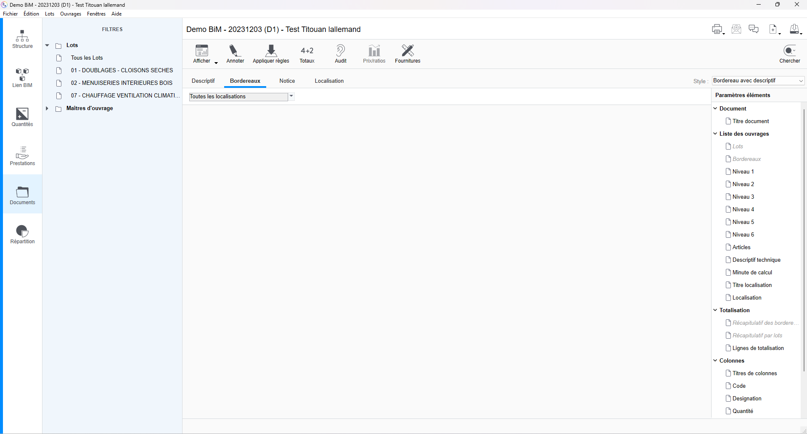
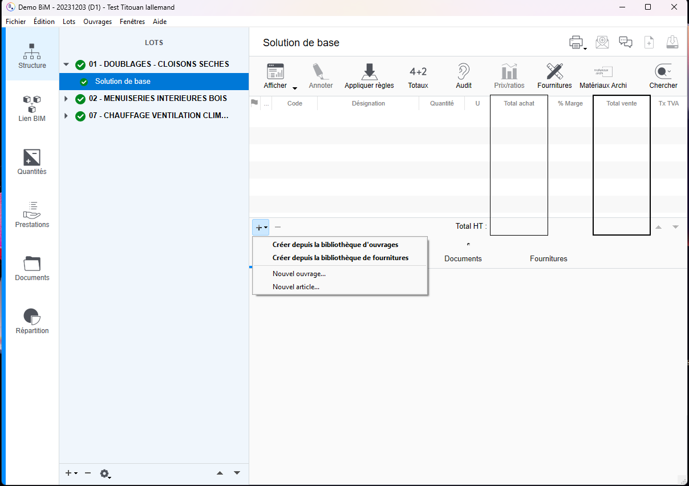
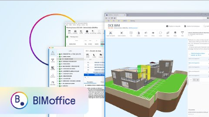
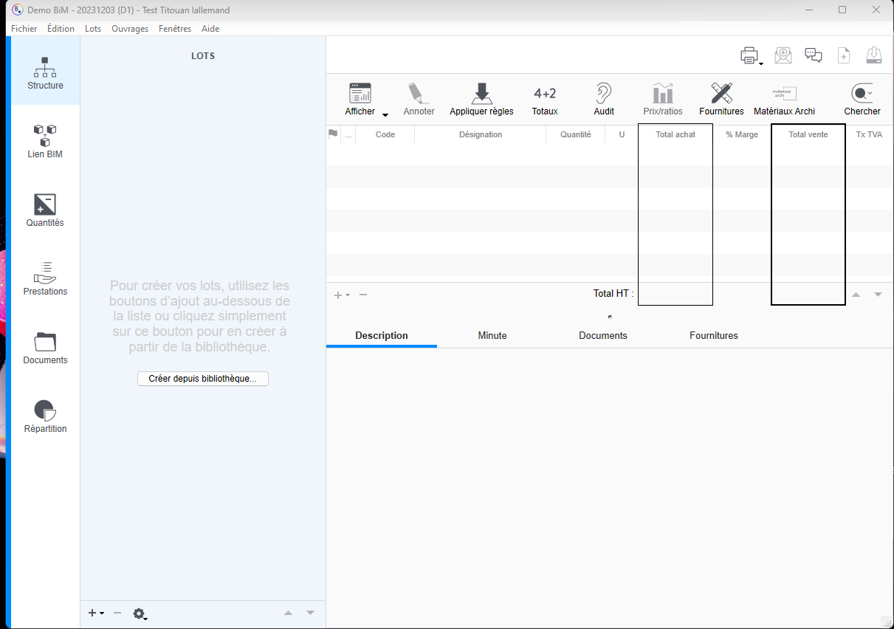
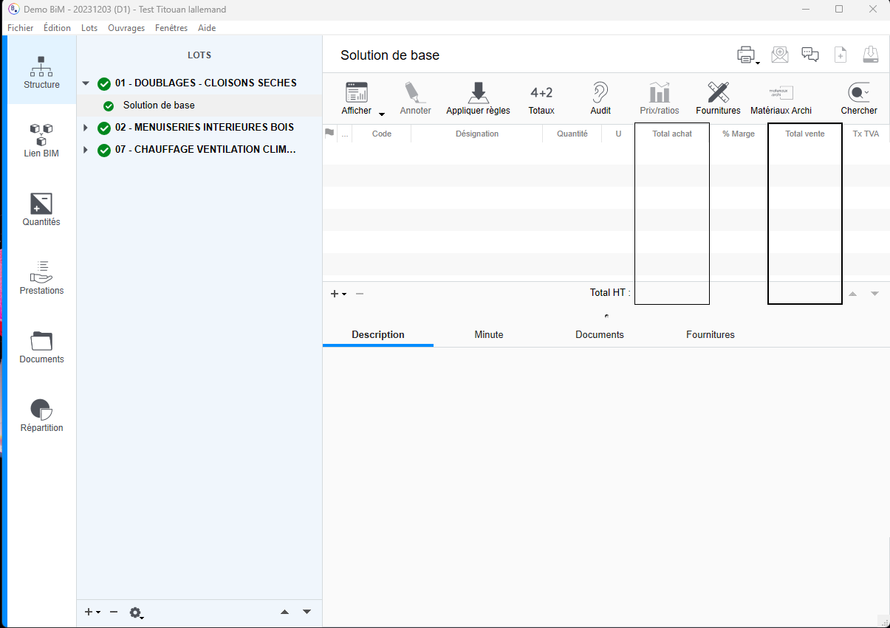
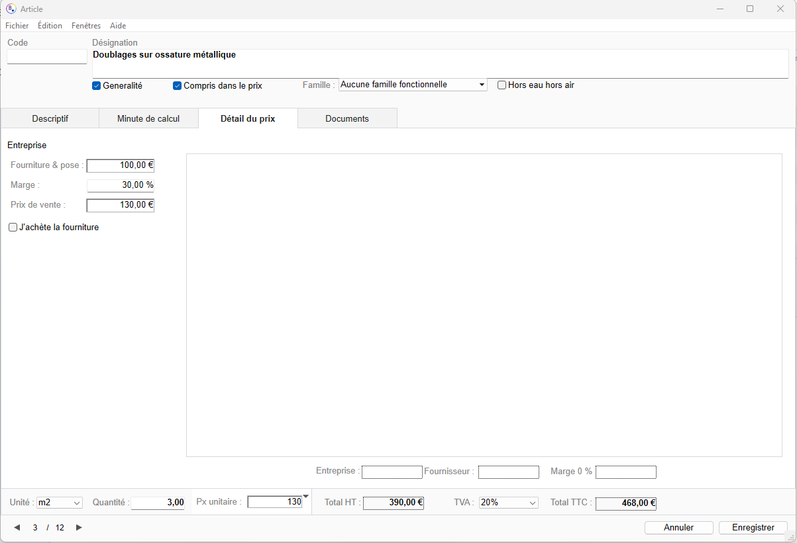
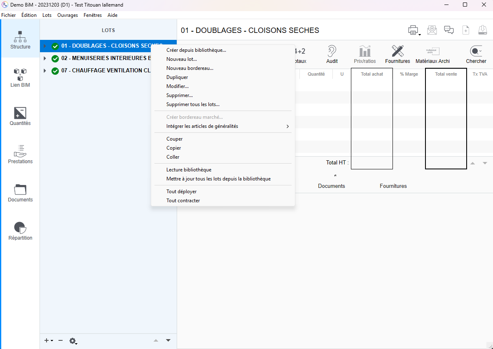
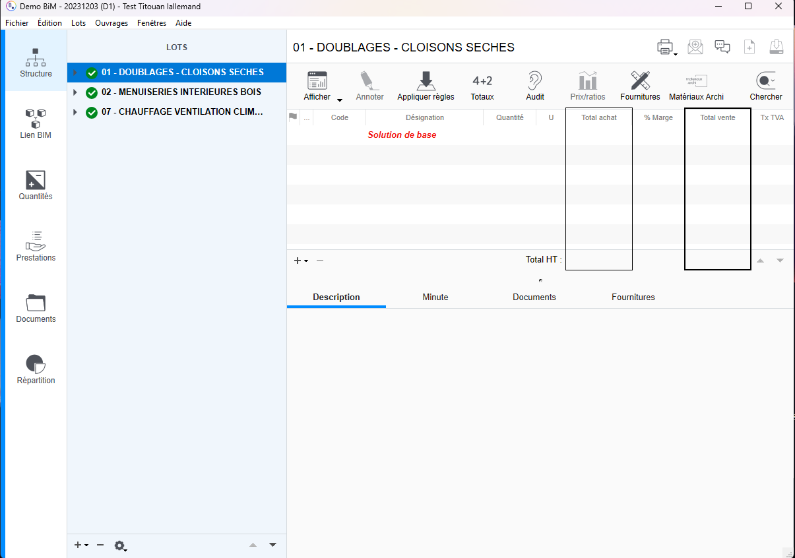

# Ajouter et chiffrer des ouvrages depuis une bibliothèque

**Logiciel :** BIMoffice Client  
**Version :** 9.17.31 (version utilisée chez Primmosens, à vérifier pour ces captures)  
**Catégorie :** Études techniques  

## Procédure

### Étape 1

Choisir le lot où ajouter des ouvrages et aller dans solution de base

### Étape 2

Cliquer sur le + puis bibliothèque d'ouvrages

### Étape 3

L'onglet ouvert est déjà sur le bon corps d'état, trouver l'ouvrage à ajouter en fonction de vos besoins dans les menus déroulants puis cliquer sur ajouter en bas à droite. La fenêtre reste ouverte pour pouvoir ajouter autant d'ouvrages que vous le souhaitez et fermez la lorsque vous avez terminé l'ajout

### Étape 4

Les ouvrages sont rangés selon la catégorie mise dans la bibliothèque et insérer directement avec le prix de la bibliothèque

### Étape 5

En double cliquant sur un ouvrage, vous pouvez modifier sa désignation, sa description ou bien encore la quantité

### Étape 6

En changeant pour aller dans l'onglet Détail du prix vous pouvez ajouter le prix de fourniture et de pose, la marge que l'on souhaite réaliser et cela calculera le prix de vente directement ou bien mettre directement le prix de vente

### Étape 7

Pour ajouter un prix plus efficacement vous pouvez cliquer sur un article et appuyer sur le bouton Prix/ratios dans les onglets au-dessus de tous les ouvrages

### Étape 8

Dans cet onglet vous pouvez voir tous les prix déjà dans la base de données via d'autres projet et voir des statistiques du prix d'achat et du prix de vente et cliquer sur le prix statistique que vous souhaitez utiliser et appuyer sur le bouton en bas Utiliser dans l'étude

