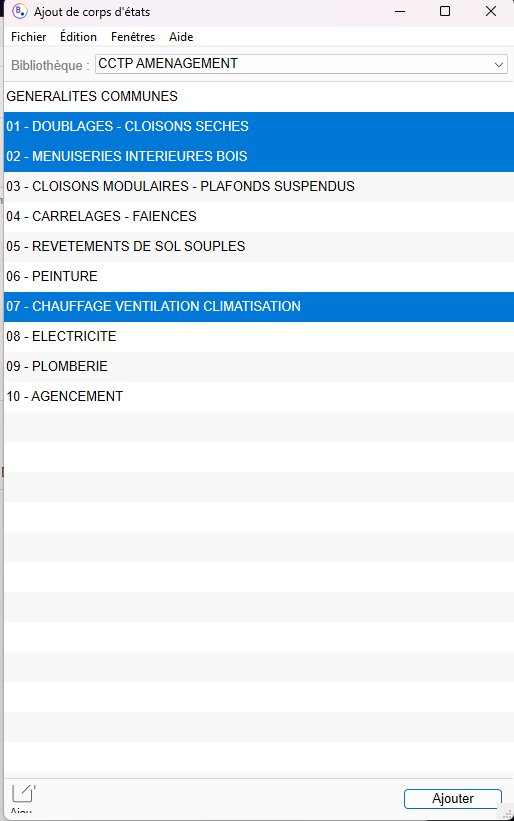

# Ajouter des lots depuis une bibliothèque dans BIMoffice

**Logiciel :** BIMoffice Client  
**Version :** 9.17.31  
**Catégorie :** Études techniques

---

## Objectif

Ajouter des lots à une étude technique à partir d'une bibliothèque existante dans BIMoffice.

## Étape 1 — Accéder à la bibliothèque

Dans l'onglet **Lots**, cliquez sur le bouton **« Créer depuis bibliothèque »**.

## Étape 2 — Sélectionner les lots

1. Choisissez la bonne bibliothèque dans le menu déroulant situé en haut de la fenêtre.
2. Maintenez la touche **Ctrl** enfoncée et cliquez sur les lots que vous souhaitez ajouter.
3. Cliquez sur **« Ajouter »**, en bas à droite de la fenêtre.

## Étape 3 — Vérifier les lots ajoutés

Les lots sélectionnés sont maintenant visibles dans l'onglet situé à gauche.

Vous pouvez ajouter d'autres lots si nécessaire.

## Étape 4 — Supprimer un lot

Pour supprimer un lot :

1. Faites un **clic droit** sur le lot concerné.
2. Sélectionnez **« Supprimer »**.

---

## Résultat attendu

Les lots sélectionnés dans la bibliothèque sont ajoutés à votre étude technique BIMoffice.
